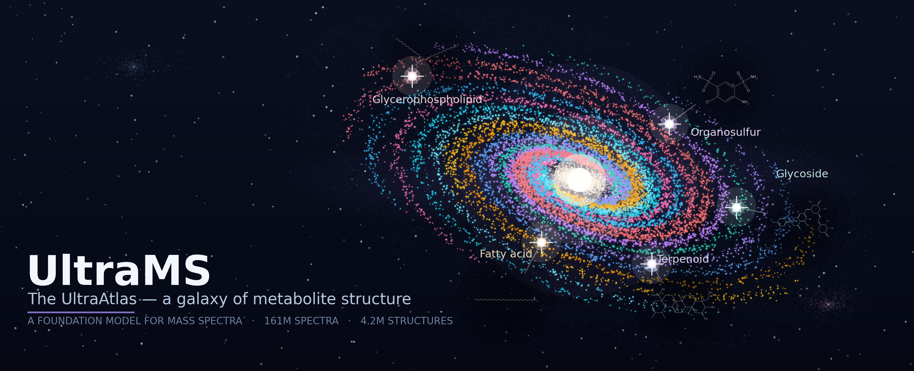

# UltraMS

[](https://github.com/Dsadd4/UltraMS/actions/workflows/ci.yml)
[](https://pypi.org/project/ultrams/)
[](https://github.com/Dsadd4/UltraMS/blob/main/pyproject.toml)
[](https://github.com/Dsadd4/UltraMS/blob/main/LICENSE)
[](https://doi.org/10.5281/zenodo.23963489)
[](https://doi.org/10.5281/zenodo.23964105)
[](https://doi.org/10.5281/zenodo.24091278)

**Pretrained models for tandem mass spectra.** Turn MS/MS spectra into embeddings, compare spectra, or fine-tune the encoder for a measured property. UltraMS is a ~200 M-parameter transformer encoder pretrained on 161 million experimental MS/MS spectra (UltraMSdata) and released with pretrained weights, pretraining code, benchmark code, and the source data behind the manuscript figures.

## Install

```bash
python -m pip install ultrams
```

- Reads MGF and `.mgf.gz` out of the box; `python -m pip install 'ultrams[io]'` adds mzML support.
- CPU, CUDA and Apple MPS devices are supported (`device="cuda"`, `device="mps"`).
- Python 3.10 or newer; `torch` and `transformers` are installed as dependencies.
- From a checkout: `python -m pip install -e .`

## Quick start

| I want to… | Start here |
| --- | --- |
| Embed one spectrum | [Python example](#embed-a-spectrum) |
| Embed an MGF or mzML file | [File command](#embed-a-spectrum-file) |
| Train on my labelled spectra | [PyTorch example](#fine-tune-with-pytorch) · [complete MGF example](https://github.com/Dsadd4/UltraMS/blob/main/examples/pytorch_finetune.py) |
| Compare spectra | [Search example](https://github.com/Dsadd4/UltraMS/blob/main/examples/spectrum_search.py) |
| Learn in a notebook | [UltraMS tutorials](https://github.com/Dsadd4/UltraMS/tree/main/cookbook/tutorials) |
| Inspect or run pretraining | [Training code](https://github.com/Dsadd4/UltraMS/blob/main/training/README.md) |
| Reproduce the paper benchmarks | [Spectral properties and molecular identification](https://github.com/Dsadd4/UltraMS/blob/main/benchmarks/README.md) |
| Inspect manuscript figure source data | [Figure 2 and Figure 3 source data and rendered panels](https://github.com/Dsadd4/UltraMS/blob/main/paper_figures/README.md) |
| Use the public API / CLI reference | [API and CLI](https://github.com/Dsadd4/UltraMS/blob/main/docs/api.md) |

<p align="center">
  
</p>

<p align="center"><em>The UltraAtlas — a galaxy of metabolite structure. Spiral arms are UltraAtlas chemical classes scaled by their real member counts, with real representative molecules as the bright stars; the spiral layout, core and halo are an artistic rendering.</em></p>

## Embed a spectrum

```python
from ultrams import UltraMS

model = UltraMS.from_pretrained("unsupervised")
embedding = model.encode(
    mz=[100.1, 121.1, 150.0],
    intensity=[20, 100, 35],
    precursor_mz=301.2,
).embedding
print(embedding.shape)  # (1024,)
```

The first call downloads the selected checkpoint from Hugging Face. Use `device="cuda"` or `device="mps"` with `from_pretrained` to run on an available accelerator.

The three checkpoints are collected on [Hugging Face](https://huggingface.co/collections/dsadd4/ultrams-6ab4cfaa860cbbd1f9a6b9b6).

## Embed a spectrum file

```bash
ultrams-embed spectra.mgf embeddings.npz --model unsupervised
```

The output has aligned `ids` and `embeddings` arrays. To use mzML, first run `python -m pip install 'ultrams[io]'`; the base installation reads MGF and `.mgf.gz` without an extra file-format package. The [checked-in example](https://github.com/Dsadd4/UltraMS/tree/main/examples) includes five real MS/MS spectra and a complete Python batch workflow.

## Fine-tune with PyTorch

`UltraMS` is a `torch.nn.Module`. Each dataset item contains peak `mz`, peak `intensity`, `precursor_mz`, and a measured numeric `target`. The two rows below are runnable example data; substitute your measured spectra and targets for research.

```python
import torch
from torch.utils.data import DataLoader
from ultrams import UltraMS

dataset = [
    {"mz": [100.1, 121.1, 150.0], "intensity": [20, 100, 35], "precursor_mz": 301.2, "target": 0.5},
    {"mz": [102.1, 135.2, 167.3], "intensity": [40, 100, 25], "precursor_mz": 315.3, "target": 0.7},
]
device = "cuda" if torch.cuda.is_available() else "cpu"
model = UltraMS.from_pretrained("unsupervised", device=device).train()
head = torch.nn.Linear(model.embedding_dim, 1).to(device)
loader = DataLoader(dataset, batch_size=2, collate_fn=model.batch_converter())
optimizer = torch.optim.AdamW([*model.parameters(), *head.parameters()], lr=1e-5)

for batch in loader:
    batch = {name: value.to(device) for name, value in batch.items()}
    prediction = head(model(batch["peaks"], batch["attention_mask"], batch["precursor_mz"]))
    loss = torch.nn.functional.mse_loss(prediction.squeeze(-1), batch["target"])
    optimizer.zero_grad()
    loss.backward()
    optimizer.step()
    print(f"loss: {loss.item():.4f}")
```

The [complete fine-tuning example](https://github.com/Dsadd4/UltraMS/blob/main/examples/pytorch_finetune.py) reads an MGF file and saves training history. For a shorter route, use `model.finetune(labelled_spectra, task="regression")` with a `label` field; it saves weights, configuration, and losses. See [spectrum input](https://github.com/Dsadd4/UltraMS/blob/main/docs/data-format.md) for the input format.

For measured molecular labels, the [MassSpecGym contrastive tutorial](https://github.com/Dsadd4/UltraMS/blob/main/cookbook/tutorials/MASSSPECGYM_CONTRASTIVE.md) downloads the dataset, keeps its train/validation/test folds, fine-tunes the encoder, and reloads the selected checkpoint.

## Choose a model

| Model name | Representation | Dimension | Spectral peak limit | Weights |
| --- | --- | ---: | ---: | --- |
| `unsupervised` | Encoder spectrum embedding | 1024 | 150 | [Unsupervised](https://huggingface.co/dsadd4/UltraMS-Unsupervised) |
| `mona` | MoNA contrastive projection | 1024 | 100 | [MoNA contrastive](https://huggingface.co/dsadd4/UltraMS-MoNA-Contrastive) |
| `search` | UltraAtlas search projection | 512 | 150 | [Search](https://huggingface.co/dsadd4/UltraMS-Search) |

Load any of them with `UltraMS.from_pretrained("name")`, or load a downloaded `model.pt` with `UltraMS.from_checkpoint(path)`. [Model selection](https://github.com/Dsadd4/UltraMS/blob/main/docs/model-selection.md) explains the training purpose and output of each checkpoint. The Search checkpoint is the **UltraAtlas application `best.pt`**.

## Data and models

Pre-trained checkpoints:

| Checkpoint | Training data | Size | Weights |
| --- | --- | ---: | --- |
| Unsupervised | UltraMSdata pretraining + retention time | ~0.8 GB | [HF](https://huggingface.co/dsadd4/UltraMS-Unsupervised) |
| MoNA contrastive | MoNA contrastive | ~1.2 GB | [HF](https://huggingface.co/dsadd4/UltraMS-MoNA-Contrastive) |
| Search | UltraAtlas spectrum-to-spectrum contrastive | ~1.0 GB | [HF](https://huggingface.co/dsadd4/UltraMS-Search) |

Released reference data (the paper's benchmark inputs are downloadable from public sources; see each benchmark page):

| Dataset | Contents | DOI | Mirror |
| --- | --- | --- | --- |
| UltraMS MSnLib benchmark | Full MSnLib library (560,084 spectra) with the UltraMS formula-level 80/10/10 split; strict-adduct molecule-level 70/15/15 split with queries and libraries for library search | [10.5281/zenodo.23963489](https://doi.org/10.5281/zenodo.23963489) | [HF](https://huggingface.co/datasets/dsadd4/UltraMS-MSnLib-Benchmark) |
| UltraMSdata file manifest | File-level inventory of the 824,828 open-format MS/MS files (3,062 MassIVE datasets) used as the pretraining-corpus inventory | [10.5281/zenodo.24071783](https://doi.org/10.5281/zenodo.24071783) | — |
| UltraMS SpectraVerse dataset | 464,346 SpectraVerse spectra with a frozen molecule-level 8:1:1 split; used for the negative-ion structure-family evaluation and as one of the three structure-annotated sources | [10.5281/zenodo.23964105](https://doi.org/10.5281/zenodo.23964105) | [HF](https://huggingface.co/datasets/dsadd4/UltraMS-Spectraverse-Dataset) |

Manuscript figure source data and rendered panels (Figure 2 and Figure 3, including the supplementary NPLIB1, MassSpecGym and MSnLib comparisons) are in [`paper_figures/`](https://github.com/Dsadd4/UltraMS/blob/main/paper_figures/README.md). The plotting scripts are not redistributed; filenames are kept as provenance references.

## Pretraining

The [UltraMSdata pretraining package](https://github.com/Dsadd4/UltraMS/blob/main/training/README.md) contains the current model architecture, training entry points, configuration and history outputs. It installs separately from the inference package.

## Benchmarks

The [benchmark code and results](https://github.com/Dsadd4/UltraMS/blob/main/benchmarks/README.md) cover spectral properties and molecular identification. The task pages link to public input downloads, training and test commands, and the measured results.

## Paper figures

[`paper_figures/`](https://github.com/Dsadd4/UltraMS/blob/main/paper_figures/README.md) contains the plotted source data and rendered panels for Figure 2 and Figure 3, including the supplementary NPLIB1, MassSpecGym and MSnLib comparison panels. The plotting scripts themselves are not redistributed; filenames are kept as provenance references. Each figure has a panel-by-panel README and a `panel_manifest.json` provenance ledger; large evaluation arrays are not redistributed and their sources are documented.

## Repository layout

| Path | Contents |
| --- | --- |
| `src/ultrams/` | Installable inference package (`UltraMS`, `UltraMSPredictor`, spectrum readers, CLI) |
| `training/` | Pretraining and adaptation package (model architecture, data tools, configs, entry points) |
| `benchmarks/` | Benchmark input preparation, training/evaluation code, saved outputs and metric recalculation |
| `paper_figures/` | Plotted source data, rendered panels and provenance ledgers for Figures 2 and 3 |
| `examples/` | Runnable embedding, fine-tuning and spectrum-search examples |
| `cookbook/` | Tutorials and notebooks |
| `docs/` | Spectrum input format, model selection, API/CLI reference, FAQ |
| `hub/` | Model cards for the released checkpoints |
| `tests/` | Unit tests and released-checkpoint verification |

## Documentation

- [Spectrum input and preprocessing](https://github.com/Dsadd4/UltraMS/blob/main/docs/data-format.md)
- [Model selection](https://github.com/Dsadd4/UltraMS/blob/main/docs/model-selection.md)
- [Python API and CLI](https://github.com/Dsadd4/UltraMS/blob/main/docs/api.md)
- [FAQ and troubleshooting](https://github.com/Dsadd4/UltraMS/blob/main/docs/faq.md)
- [Examples](https://github.com/Dsadd4/UltraMS/blob/main/examples/README.md) · [Tutorials](https://github.com/Dsadd4/UltraMS/blob/main/cookbook/tutorials/README.md) · [Training](https://github.com/Dsadd4/UltraMS/blob/main/training/README.md) · [Benchmarks](https://github.com/Dsadd4/UltraMS/blob/main/benchmarks/README.md)

## Hardware

Embedding is lightweight: a single spectrum encodes in milliseconds on CPU, and batches use the standard `torch` device selection (`cuda`, `mps` or `cpu`). Checkpoint download requires network access to Hugging Face on first use; subsequent runs use the local Hugging Face cache. Peak limits are 100–150 retained peaks per spectrum depending on the checkpoint (see [model selection](https://github.com/Dsadd4/UltraMS/blob/main/docs/model-selection.md)).

## Contributing

Bug reports, benchmark issues and pull requests are welcome; see [CONTRIBUTING.md](https://github.com/Dsadd4/UltraMS/blob/main/CONTRIBUTING.md). Release notes are in [CHANGELOG.md](https://github.com/Dsadd4/UltraMS/blob/main/CHANGELOG.md).

## License

UltraMS is released under the [Apache License 2.0](https://github.com/Dsadd4/UltraMS/blob/main/LICENSE). Third-party components keep their original licenses (for example the MAGMa-derived annotation modules under `benchmarks/spectral_properties/magma_support/` carry the MIST MIT notice).

## Cite

Citation metadata for this software is in [CITATION.cff](https://github.com/Dsadd4/UltraMS/blob/main/CITATION.cff). The archived code release used in the manuscript is at [doi:10.5281/zenodo.24091278](https://doi.org/10.5281/zenodo.24091278). If you use the released benchmark data, cite the corresponding dataset DOIs listed under [Data and models](#data-and-models).

```bibtex
@software{ultrams,
  title   = {UltraMS: pretrained models for tandem mass spectra},
  author  = {Li, Yifan and Zhong, Yunhua and Liu, Pan and Xia, Jun},
  year    = {2026},
  version = {0.3.0},
  url     = {https://github.com/Dsadd4/UltraMS},
  license = {Apache-2.0}
}
```
